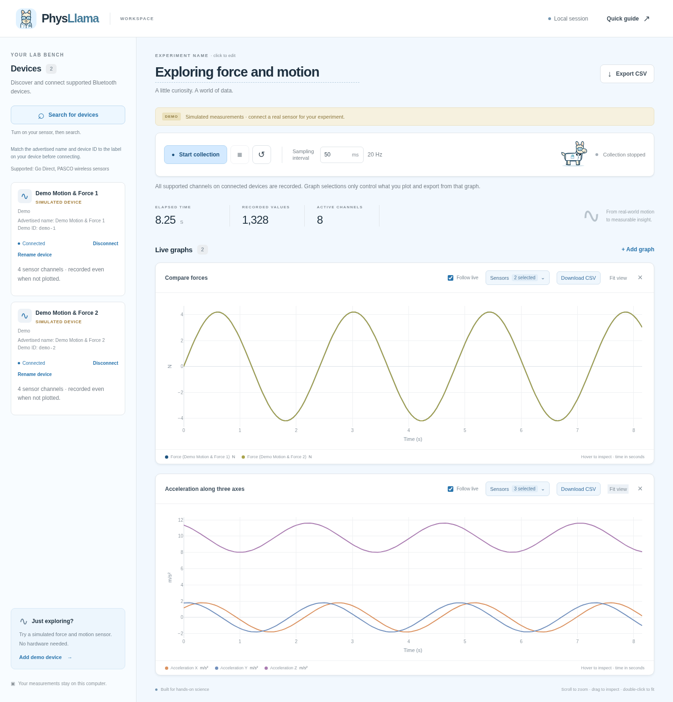
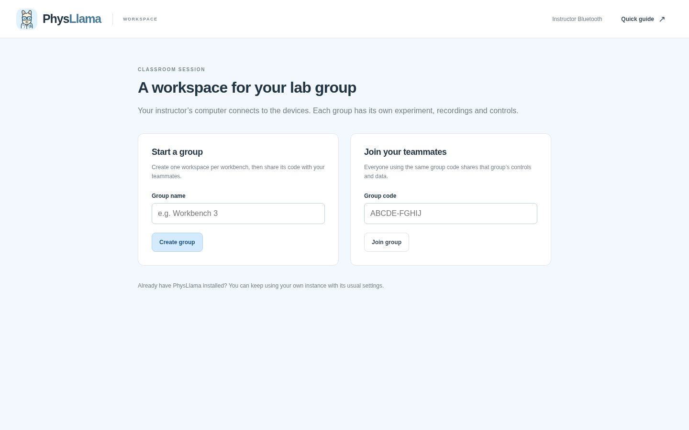

# PhysLlama

A local web app for recording and exploring Bluetooth science devices. The current adapters support Go Direct sensors, PASCO Smart Carts and ordinary PASCO wireless sensors, plus an explicit demo device; additional families can be added through the device registry. Run it on the computer with the Bluetooth adapter; the browser is the interface, and a Python service talks to the sensors. No cloud account or Web Bluetooth browser support is needed.

## Screenshots

The experiment workspace with two connected demo devices and separate force and acceleration graphs. All supported channels are recorded, including those not plotted; the top CSV contains all channels, while each graph exports only its own columns.



In instructor mode, students create a workbench group or join their teammates using a group code. The instructor’s computer provides Bluetooth for each group’s independent experiment.



Screenshots show the running app with explicitly simulated data; they do not represent physical measurements.

## Standalone installers (Windows and Mac)

PhysLlama 0.3.0 is currently a source update; renamed installers have not been built or published. Run from source below, or build the following packages using the installer instructions. Existing [older releases](https://github.com/ryanmartinneutrino/physllama/releases) predate the PhysLlama name and do not contain these changes.

| Computer | Output filename |
| --- | --- |
| Windows 11, Intel/AMD 64-bit | `PhysLlama-0.3.0-windows-x64-setup.exe` |
| Mac with Apple Silicon (M1/M2/M3/M4 or later), macOS 13+ | `PhysLlama-0.3.0-macos-arm64-installer.zip` |
| Mac with an Intel processor, macOS 13+ | `PhysLlama-0.3.0-macos-x64-installer.zip` |

These are **offline, self-contained packages**: Python, platform-specific dependencies, the app, and graphing assets are included. Students do not need Python, Node, Git, a terminal command, or an internet connection to run the installed app. The Mac install script opens Terminal to confirm installation; app launches after installation use the browser directly.

**Release status:** builds are unsigned. Previous v0.2.1 installers were tested on Windows and Mac with real Bluetooth connections. The PhysLlama rename and adapter refactor still require fresh installer and physical-device testing on each target OS. Building produces a `.sha256` file for each installer. If upgrading from the previous app name, export and quit the old app first; PhysLlama uses a new installation location and does not remove the previous installation.

### Windows

1. Run the setup `.exe`. It installs for the current user without administrator privileges.
2. Open **PhysLlama** from the Start menu or desktop shortcut. It opens the local app in your default browser.
3. Enable Bluetooth in Windows Settings, turn on the sensor, and search/connect in the app.
4. Export before closing. Choose **Quit app** in the app's header to stop the service and release Bluetooth. Closing a browser tab alone keeps the session running. Reopening the shortcut brings back that session.

Uninstall through **Settings → Apps → Installed apps → PhysLlama**, or `Uninstall.exe` in `%LOCALAPPDATA%\Programs\PhysLlama`. Quit the app before upgrading or uninstalling. Runtime diagnostics are in `%LOCALAPPDATA%\PhysLlama\Logs\app.log`.

### macOS

1. Choose the ZIP matching **Apple menu → About This Mac**: “Chip” means Apple Silicon; “Processor: Intel” means Intel. Extract it and open **START HERE - Mac.txt**.
2. In Finder, drag **PhysLlama.app** into **Applications** in your home folder (create that folder if needed). This avoids having to approve the optional installer script as well as the app. Alternatively, double-click **Install PhysLlama.command**, then type `y` and Return to copy it automatically.
3. Open the installed **PhysLlama.app**. If macOS blocks it because its developer cannot be verified, dismiss the warning, open **System Settings → Privacy & Security**, scroll to **Security**, and click **Open Anyway** for PhysLlama. Confirm **Open**, authenticating if asked. Try opening the app first so that this option appears. If using the optional `.command` installer, it may need the same approval separately.
4. Allow Bluetooth access when prompted. If previously denied, check **System Settings → Privacy & Security → Bluetooth**, enable access for the app shown there, then quit and reopen PhysLlama.
5. Export your measurements, then use **Quit app** in the browser header when finished. Closing the browser tab keeps the session alive.

Approve only the download you intended to install. There is no need to disable macOS security globally. These packages remain unsigned and unnotarized, so this first-launch approval is still necessary. See [Apple’s instructions for opening an app from an unidentified developer](https://support.apple.com/en-us/102445).

The installer never replaces an existing app silently. To update, quit PhysLlama, move the previous `.app` to Trash, and run the new installer. To uninstall, quit and move the `.app` to Trash. Logs are in `~/Library/Logs/PhysLlama/app.log`.

## Run on your Linux laptop

Requires Python 3.10+ and a working Bluetooth Low Energy adapter. On Ubuntu/Debian, install prerequisites if needed:

```bash
sudo apt install python3 python3-venv bluez
```

Clone the public repository, then launch:

```bash
git clone https://github.com/ryanmartinneutrino/physllama.git
cd physllama
./start.sh
```

The first launch creates `.venv` and installs the Python dependencies (internet required). Later launches use the existing environment. The browser opens at **http://127.0.0.1:8765**. Keep the terminal running; Ctrl+C shuts down the service and releases connected devices. All browser assets are bundled locally, so normal use needs no internet connection.

If you downloaded a ZIP, extract it and run `bash start.sh` in that directory.

```bash
./start.sh --no-browser              # open the URL yourself
./start.sh --port 8767               # use a different port
./start.sh --server --port 8080      # one shared experiment on the network
./start.sh --multi --port 8080       # independent student groups, instructor Bluetooth
```

With `--server`, open `http://<server-IP>:8080` from another computer on the network (use your chosen port). The default port is 8765. Bluetooth still runs on the server computer, so the sensors must be within its Bluetooth range. All clients share the same experiment and can control collection. Server mode has no login; use it on a trusted network. Without `--server`, the launcher listens only on `127.0.0.1`.

Enable Bluetooth in your desktop settings. Turn on a supported device, click **Search for devices**, and connect it. The Devices panel lists the supported families and labels each recognized device. Match the device’s printed ID to the scan result before connecting. Go Direct and supported PASCO devices are recognized in the same scan; nothing connects automatically. Do not connect the selected device to Graphical Analysis, LabQuest, SPARKvue, Capstone, or another app at the same time. Pairing through desktop settings is not normally required.

If scanning fails, check `bluetoothctl show` and `rfkill list`. “No default controller available” or “No Bluetooth adapters found” means the OS cannot currently expose an adapter to this app. Try the laptop's Bluetooth settings or a supported USB BLE adapter. Do not run the app as root.

## PASCO devices and workbench identification

Turn on the device and search. Every scan result shows its **advertised name**, **Bluetooth ID** (an address or OS-provided UUID), and, for PASCO, its **printed six-digit ID** such as `123-456`. Match this to the device on your own workbench before connecting; signal strength is only a proximity hint. The same scan can find multiple carts and Go Direct sensors. No red/blue assignment or serial allowlist is built in.

Smart Cart channels are position, force, acceleration X/Y/Z/resultant, and derived velocity/speed. The SDK’s known problematic cart gyro channels remain excluded, as in the original app. Ordinary wireless sensor profiles listed in `devices/pasco.py` expose their SDK-reported visible, non-internal measurements. This includes temperature, force/acceleration, motion, voltage/current and the other ordinary wireless families in the pinned SDK table. Control/code nodes, plugin hubs and actuators are not supported by this input adapter.

PASCO reads are polled, not buffered high-rate streaming. The sampling interval is a requested minimum spacing (20–10,000 ms); actual acquisition is limited by Bluetooth round trips and sensor groups. All supported cart channels are recorded, so each poll reads position, force and acceleration even if only one is plotted. The original cart app observed roughly 60 ms per sensor group, but actual rates depend on the host and device. Hiding a graph channel does not increase the acquisition rate. Battery status comes from unsolicited device packets and may take time to arrive. A charging device’s voltage-derived percentage can read high.

Choose **Rename device** while stopped to assign a display name such as “Bench 3 — red cart.” Leave it blank to restore the advertised name. Names appear in graphs and CSV but never replace the displayed hardware identity or change connection selection. In default single mode, names survive refresh, disconnect, rescan, Reset and app restart; they are shared by browsers connected to the same PhysLlama service. In `--multi` mode, nicknames belong to the group and last for that group’s session. They do not rename the device’s Bluetooth advertisement.

Saved names live in `device-names.json` under `%LOCALAPPDATA%/PhysLlama` on Windows, `~/Library/Application Support/PhysLlama` on Mac, and `$XDG_CONFIG_HOME/physllama` (normally `~/.config/physllama`) on Linux. `PHYSLLAMA_DATA_DIR` overrides that directory. The Bluetooth ID is host-specific on some operating systems, so copying this file between computers is not a portable device assignment mechanism.

The PASCO start-timeout fix explicitly preserves the original cart app’s write-without-response transport mode (Bleak changed its default after 0.20.2), accepts main-service measurement replies, and grants each sensor request its own timeout. Regression tests use mocked Bluetooth packets with the actual SDK decoder. A user has confirmed successful acquisition with a physical PASCO Smart Cart after this fix; other device models, operating systems and classroom loads still require hardware testing. On Windows and both Mac variants, scan two carts, identify each by its printed serial, rename them, record position/force/acceleration and derived speed, stop/resume, export, disconnect/reconnect, and verify that powering off one cart stops the run while retaining earlier samples. Test other sensor models with their actual hardware before classroom use.

## Instructor server and independent student workspaces

Default launch still opens one local experiment using that computer’s Bluetooth. For students who cannot install the app, run this on the instructor’s computer:

```bash
./start.sh --multi --port 8080
# Or, in an activated Python environment:
python run.py --multi --port 8080
```

Students open `http://<instructor-IP>:8080` on the same network. Allow the chosen port through the instructor’s firewall. `--multi` implies network serving and does not open a browser automatically. Plain `--server` remains available for a single shared demonstration experiment.

1. One student creates a named group for the workbench. Teammates join with the displayed group code. A browser keeps its group through refreshes; different groups should use different browser profiles/devices.
2. Search using the instructor’s Bluetooth. Match the advertised name, Bluetooth ID and printed PASCO serial to the actual device on the workbench. Connecting reserves that device exclusively for this group. Other groups see who has reserved it and cannot connect, rename, configure or release it.
3. Each group independently names its experiment, chooses channels and sampling settings, starts/stops, resets and exports. A device failure stops only its group. Teammates share acquisition and experiment names; graph layouts are local to each browser and group. Device nicknames are group-local in this mode.
4. Disconnect releases a device for another group. **End group session** stops and releases all of that group’s devices and deletes its data, after confirmation. Export first. Students cannot quit the instructor’s server from the browser; stop it in the instructor’s terminal.

The server permits up to **16 groups**, each limited to **250,000 recorded channel values**. After **30 minutes without authenticated requests**, an abandoned group stops recording and releases its devices. Its measurements and join code remain available until the group is ended or the server exits. An open connected page keeps its group active. Failed disconnections retain the reservation until the connection can be safely released.

Group codes grant access to that group’s controls and measurements; share them only with teammates. This is intended for a trusted classroom network, without instructor accounts or an administration dashboard. All Bluetooth belongs to the **instructor’s computer**, including its range, bandwidth and OS connection limits. The 16-group software limit is not a guarantee of 16 simultaneous Bluetooth connections. Physical testing with the intended devices and group count is still required.

## Bluetooth connection help

Connecting shows progress and automatically makes up to three attempts after transient failures, with a short pause and a fresh connection between attempts. Go Direct retries also refresh discovery for the exact selected Bluetooth ID instead of reusing a stale device handle. Recovery keeps discovery active until connection and notification setup finish, without disconnecting other devices such as an already-connected PASCO cart. Device-not-found errors identify the selected device rather than assuming Bluetooth is disabled; detailed failures are logged in the launching terminal. Each attempt has a 30-second budget, including sensor initialization, plus up to five seconds for cleanup. Permission errors or unavailable Bluetooth stop immediately so you can fix the settings. If cleanup fails, retries stop to avoid leaving multiple connections open.

Keep the sensor awake and nearby, enable Bluetooth, and close Graphical Analysis, LabQuest, or other apps using it. After all attempts fail, check Bluetooth permissions, power-cycle the sensor, then search and connect again. On Mac, use **System Settings → Privacy & Security → Bluetooth**. The progress banner remains available while connecting, including after a page refresh. Existing recordings are preserved; a lost connection during collection stops the run and does not automatically restart it.

## Collect and explore

- Connect one or more recognized Bluetooth devices. The Devices panel manages connections and battery status. Sensor selection happens only in graph dropdowns.
- Connect the devices to record, choose which channels to display in the graphs’ **Sensors** dropdowns, then set each device’s sampling interval on its card in the Devices panel. Each card shows that device’s maximum (and minimum) rate and any required interval multiple. New connections start at 50 ms, adjusted to fit the device. The app checks each channel’s reported limits, granularity, and mutually exclusive sensor combinations.
- **Start collection** starts a new run and the scientist llama runs beside the collection status. **Stop** keeps the data and returns the llama to its standing pose. Errors and lost server connections also stop the animation; reduced-motion preferences keep it still while the text reports the recording state. Start again to append another run, with a time gap. Stop before changing devices or sampling settings.
- Each graph has a **Sensors** dropdown with checkboxes grouped by device. **Start records all supported compatible sensor channels on every connected device**, even with no graph selections. Graph checkboxes control plotting and graph-specific CSV columns, not whether ordinary channels are recorded. New graphs start with no sensors selected. Check channels from one or more devices to overlay them; each graph keeps its own selection. All supported connected sensors are available directly in the dropdown. Disconnecting or removing a device removes its channels from graph inputs and clears their graph selections; the top CSV export still includes their recorded data. Reconnect and select the channels again to plot them. While recording, you can show or hide already-recorded channels; stop first to add a previously unrecorded sensor. Removing a graph or hiding a trace does not change what is recorded in the current or next run. For devices with mutually exclusive channels (such as alternative ranges), plotted choices take priority and the note below the collection controls lists omitted alternatives. Select an alternative while stopped and uncheck its conflicting range to use it next run. Unsupported event channels cannot be recorded. Different units use separate labeled axes; series with the same units share an axis.
- Click the **experiment name** at the top to rename the experiment. The name is shared with teammates and used in the top CSV filename.
- Graphs have a single editable title. Automatic titles renumber after deletion; custom titles survive deletion of other graphs and page reloads.
- Graphs plot each recorded sample as a separate point, with no connecting line, so the plot shows exactly when data was collected. Hovering shows the samples nearest the cursor in a box and rings each of those samples on the plot.
- Scroll to zoom, drag a zoom rectangle, or select pan in the Plotly toolbar. Hover for the sensor, value, units, time, and run. Zooming switches off **Follow live**. **Fit view** resets the axes; check **Follow live** to keep fitting new samples.
- **Download CSV** on a graph exports only that graph’s checked sensors, across all recorded runs, regardless of zoom or display reduction. Its filename includes the graph title. **Export CSV** at the top exports **every recorded channel from all connected devices**, including unplotted channels and data from devices subsequently disconnected. Both CSV buttons retain every experiment timestamp and run; graph exports filter only the columns. Measurements that were not acquired in an older recording cannot be recovered retroactively. The Plotly camera button exports a graph as an image.
- **Reset** asks before removing all collected runs. It preserves device connections and the graph layout.
- The battery reading comes from the device when connected. Click its **refresh** label while stopped to update it. No battery percentage is invented for demo devices or devices with an unavailable reading.

**Add demo device** provides clearly labeled generated force/acceleration measurements for trying the interface without hardware. Add it more than once to test multiple devices. Synthetic and real measurements cannot be recorded in the same session, even across separate runs; export and reset before switching. Disconnect demo devices before starting real acquisition; unchecking their graph channels does not exclude them from recording.

## Save and open experiments

**Save experiment** downloads a `.physllama` file (JSON) containing the experiment name, each device with its identity, nickname, channel list, recorded channels and sampling interval, every recorded series and sample, and the graph layout (titles, selected channels, Follow live). **Open experiment** loads such a file so you can pick up where you left off. It asks first if the current experiment has data or plotted channels, because opening replaces the experiment's data, name and graphs. Collection must be stopped to save or open.

- Recorded data appears on the graphs immediately, before any hardware reconnects.
- Demo devices are recreated and connected automatically. Real devices appear as dashed “From the opened experiment” cards. Search and connect them as usual; a device with the same Bluetooth ID gets its saved channels and interval back, and its graph selections continue. Bluetooth IDs on macOS are specific to each computer, so a file opened on another Mac shows those devices as not found; connect the matching device and select its channels again.
- New runs continue after the saved ones (run numbers and time). Time while the experiment was closed is not counted: the next run starts where the saved timeline ended, plus any time after opening.
- Saved nicknames are restored. Files are validated completely before anything changes; invalid or newer-version files are rejected with an explanation. Demo and real measurements cannot be mixed in one file.

## How sampling works

The **sampling interval** is the time between samples (rate in Hz = 1000 ÷ interval). **Each device has its own interval**, set on its card. All channels on one device share its interval: the Go Direct protocol sets a single measurement period for every enabled channel, and a PASCO device answers one poll for all its channels. Channels can have different limits, though, so the interval decides what is recorded. Unplotted channels are recorded only if they accept the interval, so a slow channel you aren’t plotting never limits a fast one (for example, acceleration at 100 Hz on a device whose force channel only reaches 20 Hz). Plotted channels are always recorded, so they set the allowed range: plotting a slower channel limits the device to that channel’s rate, and Start explains the conflict until you choose a longer interval or uncheck it. The card shows the device’s maximum and minimum rate, any required multiple, the maximum rate of each channel when they differ, and when plotted channels are the limit; the note under the collection controls lists channels not recorded at the current interval. The API takes `periods: {device_id: ms}` on `/api/configure` and `/api/start`; an optional `period_ms` applies to selected devices without their own entry. How samples are taken depends on the device family:

- **Go Direct (device-clocked):** PhysLlama sends the interval to the sensor, which samples on its own clock, buffers the values, and streams them over Bluetooth. Sample times are the run’s start time plus a whole number of intervals, so spacing is exactly uniform. If the device reports dropped samples, collection stops with an error rather than silently compressing time.
- **PASCO (polled):** PhysLlama asks the sensor for a reading once per interval and timestamps each reading at the midpoint of the request and reply. Polling is capped at 50 Hz, and Bluetooth round trips can make the achieved rate lower and slightly irregular. Each PASCO device card shows the average rate achieved in the latest run.
- **Demo (simulated):** values at exactly the requested interval.

Devices are not synchronized with each other, so samples from different devices generally fall at different times. The CSV keeps each device’s samples at its own times (see below).

## Data, units, and timing

The app records SDK-decoded measurements without extra scaling or calibration. Smart Cart position is zeroed at the first sample of each run, matching the previous cart app; its derived velocity and speed use a rolling least-squares fit to the last three position samples. Derivative history is cleared on every Start, so it never spans a pause. Initial or unavailable derivatives are missing values, not invented zeros. Other measurements have no additional zero offset. An empty unit field is labeled `a.u.` (arbitrary units). Device calibration is handled by the device firmware and its adapter library. Advanced calibration workflows and aperiodic/event channels are not implemented.

CSV is in **wide format**: one row per sample time, one column per recorded sensor channel, plus `run` and `time_s`. For example, with two devices whose samples were taken at different times:

```text
run,time_s,Bench 1 — Force [N] (cart-a/1001; 123-456; Smart Cart),Bench 2 — Position [m] (cart-b/3001; 654-321; Smart Cart)
1,0.051,1.25,
1,0.063,,0.12
1,0.112,1.30,
1,0.124,,0.15
```

Headers include the current device nickname, channel name, unit, immutable channel/device ID, original advertised name when different, and printed PASCO serial when available. Demo columns also include `DEMO`. Renaming changes the header without changing raw samples or their identities. `time_s` is relative to the first Start and includes pauses; `run` distinguishes recording runs.

Rows are the **union of all actual sample times** in each run. Every cell is a raw measurement taken at exactly that row’s time; **nothing is interpolated or resampled**. A cell is blank when that channel has no sample at that time: another device’s sample time, before or after the channel was recorded, a run where it was not recorded, or a missing measurement (such as the initial cart velocity/speed). Channels from the same device share timestamps, so they fill the same rows; devices with different rates or start times fill interleaved rows. Both the top-level and graph CSV include one row for every distinct `(run, time_s)` in the experiment; graph filtering changes only the columns.

For Go Direct and demo devices, sample times are reconstructed from the requested sampling interval and the host's monotonic time immediately before each device's Start command. PASCO samples use the midpoint of the host-monotonic request/response interval, as in the Smart Cart app; their actual, potentially irregular spacing is preserved. Reading multiple sensor groups involves separate Bluetooth requests, so one batch timestamp is an approximation, not synchronized acquisition across its channels. Devices are **not hardware synchronized**, so there can be Bluetooth command latency between their actual starts. This is suitable for introductory force/motion exploration, not precise cross-device phase measurements. Reported dropped-sample packets stop collection with an error instead of silently compressing the time axis. A connection loss or data timeout also stops collection and preserves prior samples.

Data lives in the local service's memory. Refreshing or reopening the browser recovers the current session; exiting the service loses it unless you save the experiment first. The session stops at **250,000 channel values** without discarding earlier samples. Large graphs use min/max display reduction after 4,000 values per series; CSV export uses full-resolution data and preserves every recorded timestamp, independent of display reduction. Experiment names live with the experiment; graph preferences are saved in browser storage.

## Verification status

The automated backend tests cover independent group acquisition, exclusive device reservations, abandoned-session release, cancellation during connection, mixed-rate wide CSV and missing-data rules, PASCO command write mode, multi-device acquisition, units and filtered CSV, resume/reset, range/granularity/conflict checks, rollback after a failed Start, data preservation on disconnect, session limits, demo isolation, origin checks, SDK packet parsing, retry limits, partial-connection cleanup, timeouts, and connection progress while the Bluetooth worker is busy. Browser tests exercise the actual UI with two separate groups and a teammate, experiment naming, export scope, device/channel controls, mixed-unit graphs, zoom/hover/fit, export, refresh recovery, reset, error messages, and a narrow viewport.

**Windows and Mac installers and Bluetooth connections have been user-tested with v0.2.1.** The development Linux computer still has no usable Bluetooth adapter. For PhysLlama 0.3.0, repeat this physical-device smoke test, including the Mac connection retries:

1. Search and connect the powered-on sensor; check its model, channel units, and battery reading.
2. Record force and compatible acceleration channels at 50 ms for 10 seconds while gently moving the sensor.
3. Stop, hover and zoom, export the CSV, then start a second run.
4. Power off the sensor while recording and confirm the error preserves the data; power on, reconnect, and record again.
5. When a second physical device is available, repeat with both devices.

## Development

There is no frontend build step for normal use. Plotly is vendored with its license. Node is needed only for browser tests or updating that asset.

```bash
.venv/bin/python -m pip install -r requirements-dev.txt
.venv/bin/python -m pytest -q
npm ci
npx playwright install chromium
npm run test:ui
```

If Chromium is already installed in a nonstandard location, set `PLAYWRIGHT_CHROMIUM_EXECUTABLE` to its executable. Browser tests start isolated single-instance and classroom services on ports 8766 and 8767. `npm run vendor` updates the tracked Plotly asset from the pinned package.

```text
desktop.py                   Bundled desktop entry point and graceful shutdown
run.py                       Command-line launcher; --server or --multi network modes
start.sh                     Linux/macOS virtualenv setup and launch
physllama/server.py          HTTP API and static asset serving
physllama/classroom.py       Group sessions and exclusive Bluetooth reservations
physllama/csv_export.py      Wide CSV, one row per sample time, no interpolation
physllama/experiment_file.py Save/open experiment files (.physllama) with full validation
physllama/acquisition.py     Serialized Bluetooth worker and session store
physllama/hardware.py        Shared Bluetooth scan and device registry
physllama/devices/base.py    InputDevice, BluetoothDriver, Channel and Reading contracts
physllama/devices/godirect.py Go Direct adapter and SDK compatibility fixes
physllama/devices/demo.py    Explicit simulated device
physllama/devices/pasco.py   PASCO workers, transport compatibility, and cart processing
physllama/names.py           Saved display names; immutable identity remains separate
physllama/vendor/pasco/      Pinned PASCO decoder/data tables, license and provenance
physllama/static/           HTML, CSS, SVG llama, JavaScript, and bundled Plotly
packaging/                   Runtime checksums, dependency locks, installer templates
scripts/build_installers.py  Offline Windows/Mac installer assembly
tests/                       Backend and browser tests
```

The Lab worker serializes session operations and Go Direct SDK calls. Each PASCO device owns its own worker and BLE event loop, reusing the Smart Cart app’s design, so its request/response latency does not block another cart or the HTTP state endpoint. PASCO workers return timestamped batches through bounded queues. Stop waits for the current bounded polling cycle (up to two seconds per requested sensor group), then stops further polling. In single mode, Bluetooth discovery and connection requests remain serialized through Lab; in multi mode, a classroom radio lock serializes discovery/connection across groups while each group has its own Lab worker. The browser polls bounded incremental batches and can rebuild its state after a reload. By default the service binds to `127.0.0.1` and accepts local hostnames only. `--server` binds to `0.0.0.0` and accepts network hostnames; both modes reject requests with an Origin that differs from the request's host. Multiple tabs and clients share one experiment in default and `--server` modes; `--multi` isolates experiments by group.

The adapter includes focused compatibility fixes for godirect 1.2.1: BLE notification reassembly, full 32-bit channel masks, correct single-channel routing, and explicit dropped-sample handling. Metadata packets are skipped, including during command responses. Hardware validation is still required on the target sensor.

## Adding another device family

The browser, HTTP routes, plots, and CSV export use the shared `InputDevice` contract in `physllama/devices/base.py`. No manufacturer-specific branching belongs in those layers. The Go Direct protocol patches and bitmask conversion stay inside `devices/godirect.py`.

1. Add an adapter module under `physllama/devices/` implementing `InputDevice`. Give devices stable IDs (normally their BLE address), a driver ID and family label, channel metadata, optional battery information, and the shared `open(progress)`, `start`, `read`, `stop`, `close`, and `refresh_battery` methods. `close` must release partial connections and be safe to repeat. `open` must clean up failures and report progress; retry policy and SDK-specific deadlines belong in the adapter.
2. Describe channels with stable integer numbers, names, units, supported sampling ranges, interval granularity (`0` for unrestricted), and `excluded_channels` lists. Convert any vendor bitmasks inside the adapter. Unsupported event channels can be listed with `supported=False`. The current UI accepts a shared 10–10,000 ms requested interval, validated against every selected channel; independently configured rates and event streams would need a further acquisition/UI extension.
3. Return per-channel batches from `read`: floats for uniform buffered acquisition, or `Reading(value, timestamp)` for irregular measurements. Explicit timestamps are in the host's `time.monotonic()` clock, taken at acquisition, and must not precede the run's start or move backwards within a channel. Convert device-clock timestamps before returning them. Keep reads bounded so another device and Stop can be serviced; slow SDKs should use a bounded queue behind the adapter with explicit loop/thread ownership. Never silently drop samples to catch up.
4. Implement a `BluetoothDriver` with `id`, `label`, `matches(BLEDevice, AdvertisementData)`, and `create(...)`; register it in `default_registry()` in `hardware.py`. Match advertised service/manufacturer data or a verified family identifier. Discovery runs once for all drivers, ignores unknown devices, rejects ambiguous matches, and passes the scanned device to its adapter. Factories must not connect during discovery. Connected devices retain their original instances when rescanning. Demo devices are added explicitly and never appear as discovered hardware.
5. Add mock discovery, connection cleanup, channel validation, timing, stop/disconnect and export tests, then test real hardware on target operating systems. `tests/test_devices.py` exercises two independent fake families through the unchanged scan/connect/acquisition/export API. Package any new SDK dependency and its license in all platform locks before distributing it.

The PASCO adapter reuses the [Smart Cart app at commit 28f70c5](https://github.com/ryanmartinneutrino/pascowebapp/tree/28f70c55ea5fd7eea4aa28b75b2ee3086c976de9): per-device workers, bounded reads, unsolicited battery decoding, request/response midpoint timestamps, start-of-run position zeroing, and least-squares derived velocity/speed. Its explicit cart channels also avoid the known gyro decoder issue. The live derivative uses the last three samples so values can be recorded immediately; future samples are not used to revise earlier CSV values. PhysLlama retains its own graph/CSV interface and run semantics.

Discovery replaces hard-coded serial numbers with a model/encoded-interface match against the SDK’s device table and the serial in the advertisement. Connection uses the exact scanned BLE object on Linux/Windows. CoreBluetooth scan results retain their originating event loop, so on macOS a device worker receiving a scan result from another loop resolves the same selected Bluetooth UUID on its own loop before connecting; it never falls back to a nickname or a different device. These targeted lookups remain serialized with connection requests. The old app’s automatic reconnect and system-wide BlueZ disconnection helper are not used: a failed run stops and preserves data, and PhysLlama only releases connections it owns. A fresh connection attempt uses a new SDK instance with bounded retries and partial-connection cleanup.

The PASCO 0.3.65 decoder and datasheet used by that app are bundled under `physllama/vendor/pasco/`, with their original license, source hashes and provenance. Installing its PyPI distribution directly would require an incompatible Bleak 0.20.2 pin and Python 3.11+, while PhysLlama uses Bleak 3.1.0 and Python 3.10+. The bundled core removes the global `nest_asyncio` patch; the adapter supplies explicit loop ownership, Python 3.10-compatible bounded command tasks, modern Bleak UUID handling and scanned-device connections. Protocol decoding and calibration tables remain upstream code. No additional PyPI dependency or platform lock change is needed; installers include these sources and notices in their manifests.

The Python package is now `physllama`. Browser layouts are saved under `physllama-layout`, with a read fallback for the previous key so existing titles and graph choices survive the rename on the same browser origin.

## Rebuilding standalone installers

The builder assembles target-native packages without compiling foreign binaries. It downloads the pinned Astral standalone Python 3.12 runtime, verifies its SHA-256, and installs only target-native wheels from hashed per-platform lock files. The same Python source and local browser assets are included on every platform. Every bundle includes its source commit and file hashes in `BUILD-MANIFEST.json`, the Python library sources, and third-party notices.

Install the builder dependency and NSIS (NSIS is required only for Windows setup output):

```bash
.venv/bin/python -m pip install -r requirements-build.txt
# Ubuntu/Debian build host, Windows setup compiler:
sudo apt install nsis
.venv/bin/python scripts/build_installers.py --target all
```

Individual targets are `windows-x64`, `macos-arm64`, and `macos-x64`. `--uv` and `--makensis` can supply explicit executable paths. On Windows use the virtualenv's `Scripts/python.exe`, or any Python 3.10+ with the build dependency installed. This process needs internet while building; the resulting installers do not.

Commit source changes before building; the builder requires a clean checkout so its manifest identifies the exact source revision. Outputs are written to ignored `dist/`. The Mac ZIPs contain the offline installer, README, and a `.app` with Bluetooth usage descriptions. The Windows NSIS executable installs shortcuts and a per-user uninstaller. No GitHub Actions workflows or hosted build services are used. Upload artifacts to a GitHub release after validation; do not commit bundled runtimes into Git.

Run `.venv/bin/python scripts/verify_installers.py` after building (requires `7z`) to verify the installer checksums, every payload file against the build manifest, Mac executable permissions and Bluetooth metadata, and native Python executable formats. These integrity checks do not replace installation and Bluetooth tests on the target OS.

To regenerate dependency locks after deliberately updating `requirements.txt`:

```bash
.venv/bin/uv pip compile --python-version 3.12 --python-platform x86_64-pc-windows-msvc --generate-hashes -o packaging/requirements-windows-x64.lock.txt requirements.txt
.venv/bin/uv pip compile --python-version 3.12 --python-platform aarch64-apple-darwin --generate-hashes -o packaging/requirements-macos-arm64.lock.txt requirements.txt
.venv/bin/uv pip compile --python-version 3.12 --python-platform x86_64-apple-darwin --generate-hashes -o packaging/requirements-macos-x64.lock.txt requirements.txt
```

For a classroom release, test both CPU variants on Macs and the Windows installer on a clean Windows machine without Python. Confirm launch, Bluetooth permission, acquisition, graph-specific CSV, Quit, reopening, and uninstall. Code signing/notarization requires platform signing credentials and a macOS signing host; neither is included in this preview build.

## Upstream references

- [Vernier's Go Direct Python library](https://github.com/VernierST/godirect-py) and [official getting-started examples](https://vernierst.github.io/godirect-examples/python/)
- [Bleak Bluetooth library](https://github.com/hbldh/bleak)
- [Plotly.js](https://github.com/plotly/plotly.js)

The public GitHub repository uses no Actions workflows, and GitHub Actions is disabled in its repository settings. Third-party license notices are in `THIRD_PARTY_NOTICES.md` and the bundled Plotly license. PhysLlama is an independent project and is not affiliated with device manufacturers.
